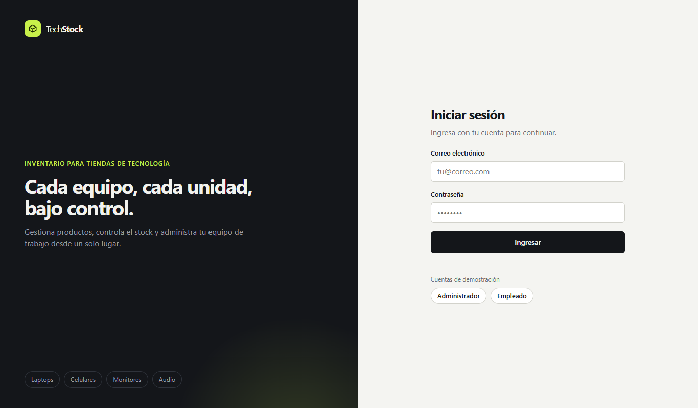
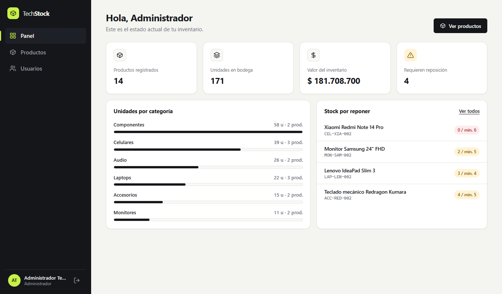
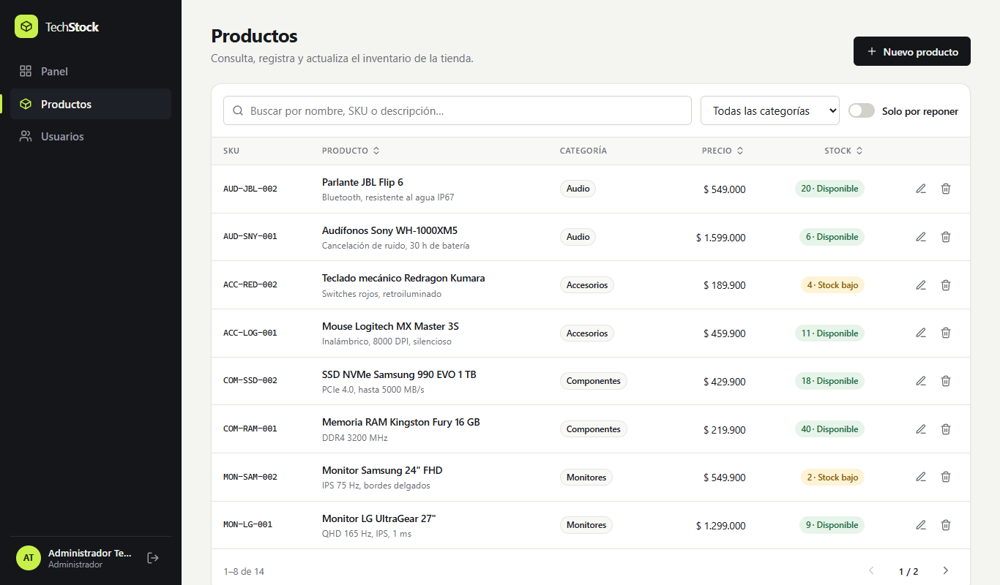
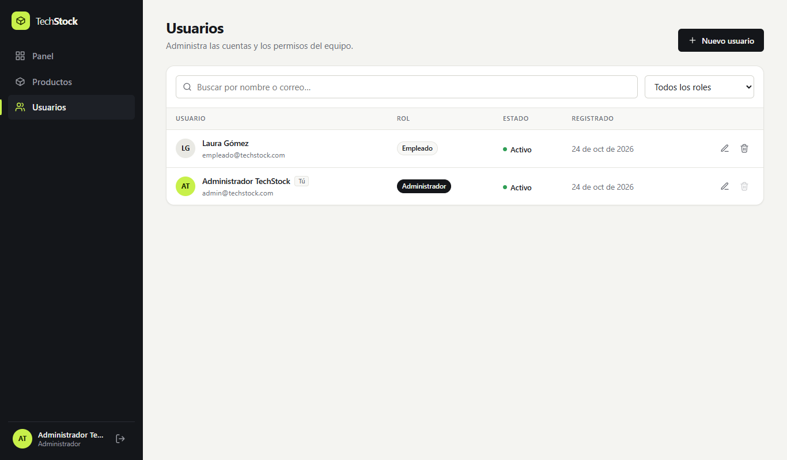

# TechStock · Aplicación web de inventario

Aplicación web full stack para una **tienda de tecnología** con dos módulos:

- **Gestión de usuarios**: crear, consultar, editar y eliminar cuentas, con roles (Administrador / Empleado) y estado (activo / inactivo).
- **Gestión de productos**: CRUD completo del inventario con búsqueda, filtros, ordenamiento, paginación, alertas de stock bajo y estadísticas.

> Evidencia **GA4-220501096-AA1-EV02 · Aplicación web funcional** — SENA, Técnico en Programación de Software.
> Autor: **Cristian Camilo Areiza Restrepo**

---

## Capturas

**Inicio de sesión**



**Panel**



**Productos**



**Usuarios**



---

## 1. Cómo ejecutarla

**Requisito:** [Node.js](https://nodejs.org) 22.13 o superior (se recomienda la versión LTS actual). No hay que instalar ninguna base de datos: se usa el SQLite integrado en Node.js.

### Opción rápida (ejecutable)

| Sistema | Acción |
|---|---|
| Windows | Doble clic en **`iniciar.bat`** |
| macOS / Linux | `./iniciar.sh` |

El script instala dependencias (solo la primera vez), compila el proyecto y abre **http://localhost:3000**.

### Opción manual

```bash
npm run setup     # instala dependencias de la raíz, backend y frontend
npm run build     # compila frontend y backend
npm start         # inicia el servidor en http://localhost:3000
```

### Modo desarrollo (recarga automática)

```bash
npm run dev       # API en :3000 y frontend Vite en http://localhost:5173
```

### Cuentas de demostración

| Rol | Correo | Contraseña |
|---|---|---|
| Administrador | `admin@techstock.com` | `Admin123*` |
| Empleado | `empleado@techstock.com` | `Empleado123*` |

En la pantalla de inicio de sesión hay botones para rellenar estas cuentas. Para reiniciar la base de datos con los datos de ejemplo: `npm run seed`.

---

## 2. Tecnologías

| Capa | Tecnología |
|---|---|
| Frontend | React 19, TypeScript, Vite, React Router |
| Backend | Node.js, Express 5, TypeScript |
| Base de datos | SQLite integrado en Node.js (`node:sqlite`), sin dependencias nativas |
| Seguridad | JWT, bcrypt, Helmet, CORS |
| Validación | Zod (backend) y validador propio orientado a objetos (frontend) |
| Pruebas | Vitest, Supertest, Testing Library, colección Postman |

---

## 3. Arquitectura

```
┌──────────────────── FRONTEND (React) ────────────────────┐
│  Páginas / Componentes  →  Servicios (clases)  →  HttpClient ──┐
│  Modelos de dominio: Product, User (clases)                    │  HTTP + JSON
└────────────────────────────────────────────────────────────────┘  Bearer JWT
                                                                   ▼
┌──────────────────── BACKEND (Express) ─────────────────────────────┐
│  Rutas → Middlewares (auth, validación) → Controladores            │
│        → Servicios (reglas de negocio) → Repositorios (SQL) → SQLite │
└──────────────────────────────────────────────────────────────────────┘
```

El backend sigue una **arquitectura por capas** con **inyección de dependencias** por constructor (`src/container.ts`): cada capa conoce solo a la siguiente, lo que facilita las pruebas y el mantenimiento.

### Programación orientada a objetos en el frontend

| Clase | Concepto POO | Responsabilidad |
|---|---|---|
| `HttpClient` | Encapsulamiento | Peticiones `fetch`, token JWT y manejo de errores |
| `ApiError` | Herencia (`extends Error`) | Error con código HTTP y errores por campo |
| `BaseCrudService<T>` | Clase abstracta + genéricos | Operaciones CRUD comunes (`getById`, `create`, `update`, `remove`) |
| `ProductService`, `UserService` | Herencia + polimorfismo (`toModel`) | Endpoints propios de cada módulo |
| `AuthService`, `TokenStorage` | Composición | Sesión del usuario |
| `Product`, `User` | Modelos de dominio | Lógica de presentación (estado de stock, precio en COP, iniciales, rol) |
| `Validator` | Patrón *fluent* | Reglas de validación reutilizables para formularios |

---

## 4. Estructura de carpetas

```
techstock/
├── iniciar.bat / iniciar.sh     # Ejecutables
├── docs/
│   └── TechStock.postman_collection.json
├── backend/
│   ├── src/
│   │   ├── config/              # Variables de entorno
│   │   ├── database/            # Conexión, esquema y datos de ejemplo
│   │   ├── models/              # Tipos de dominio
│   │   ├── repositories/        # Acceso a datos (SQL)
│   │   ├── services/            # Reglas de negocio
│   │   ├── controllers/         # Capa HTTP
│   │   ├── routes/              # Definición de endpoints
│   │   ├── middlewares/         # Autenticación, validación, errores
│   │   ├── validators/          # Esquemas Zod
│   │   ├── app.ts               # Configuración de Express
│   │   └── server.ts            # Punto de entrada
│   └── tests/                   # Pruebas de integración de la API
└── frontend/
    └── src/
        ├── core/                # HttpClient, BaseCrudService, Validator
        ├── models/              # Clases Product y User
        ├── services/            # Servicios por módulo
        ├── context/             # Sesión y notificaciones
        ├── components/          # UI reutilizable y layout
        ├── features/            # auth, dashboard, products, users
        └── styles/
```

---

## 5. API REST

Base: `http://localhost:3000/api` · Formato de respuesta: `{ "data": ... }` · Errores: `{ "error": { "message", "details" } }`

### Autenticación

| Método | Ruta | Descripción | Acceso |
|---|---|---|---|
| POST | `/auth/login` | Inicia sesión y devuelve el token | Público |
| GET | `/auth/me` | Perfil del usuario autenticado | Autenticado |

### Usuarios

| Método | Ruta | Descripción | Acceso |
|---|---|---|---|
| GET | `/users` | Listar usuarios | Admin |
| GET | `/users/:id` | Obtener un usuario | Admin |
| POST | `/users` | Crear usuario | Admin |
| PUT | `/users/:id` | Actualizar usuario (parcial) | Admin |
| DELETE | `/users/:id` | Eliminar usuario | Admin |

### Productos

| Método | Ruta | Descripción | Acceso |
|---|---|---|---|
| GET | `/products` | Listar con `search`, `category`, `lowStock`, `page`, `limit`, `sort`, `order` | Autenticado |
| GET | `/products/stats` | Estadísticas del inventario | Autenticado |
| GET | `/products/:id` | Obtener un producto | Autenticado |
| POST | `/products` | Crear producto | Autenticado |
| PUT | `/products/:id` | Actualizar producto (parcial) | Autenticado |
| DELETE | `/products/:id` | Eliminar producto | Admin |

### Códigos HTTP usados

`200` OK · `201` Creado · `204` Sin contenido · `400` Datos inválidos · `401` No autenticado · `403` Sin permisos · `404` No encontrado · `409` Conflicto (correo o SKU repetido) · `500` Error interno

---

## 6. Pruebas

```bash
npm test
```

| Suite | Herramienta | Pruebas | Qué cubre |
|---|---|---|---|
| Backend · autenticación | Vitest + Supertest | 10 | Login, token, cuentas desactivadas, JSON inválido, 404 |
| Backend · usuarios | Vitest + Supertest | 17 | CRUD, permisos por rol, correos duplicados, contraseña segura, último administrador |
| Backend · productos | Vitest + Supertest | 17 | CRUD, paginación, búsqueda, filtros, ordenamiento, estadísticas, SKU duplicado |
| Frontend · modelos | Vitest | 12 | Estado de stock, formato de moneda, iniciales, roles |
| Frontend · HttpClient | Vitest | 6 | URLs, token, 204, errores de la API, 401, error de red |
| Frontend · validación | Vitest | 7 | Reglas de productos y usuarios |
| Frontend · formulario | Testing Library | 3 | Errores, envío correcto, error del servidor |
| **Total** | | **72** | |

Además, `docs/TechStock.postman_collection.json` contiene **18 peticiones con aserciones** para probar la API manualmente desde Postman (ejecutar primero *Login administrador*).

### Plan de pruebas funcionales (manuales)

| # | Caso | Resultado esperado |
|---|---|---|
| 1 | Ingresar con contraseña incorrecta | Mensaje "Correo o contraseña incorrectos" |
| 2 | Ingresar como administrador | Se muestra el panel con estadísticas |
| 3 | Crear producto con campos vacíos | Errores debajo de cada campo, no se envía |
| 4 | Crear producto válido | Aviso de éxito y aparece en la tabla |
| 5 | Crear producto con SKU existente | Mensaje "Ya existe un producto con el SKU…" |
| 6 | Editar el stock de un producto | La etiqueta de stock se actualiza |
| 7 | Buscar, filtrar por categoría y "solo por reponer" | La tabla muestra solo coincidencias |
| 8 | Eliminar un producto | Diálogo de confirmación y desaparece de la tabla |
| 9 | Crear usuario con contraseña débil | Error de validación en la contraseña |
| 10 | Crear, editar y eliminar un usuario | Avisos de éxito en cada acción |
| 11 | Recargar la página | La sesión se mantiene |
| 12 | Ingresar como empleado | No ve "Usuarios" ni puede eliminar productos |

---

## 7. Buenas prácticas aplicadas

- **Separación de responsabilidades**: capas independientes en backend y frontend.
- **Seguridad**: contraseñas con hash bcrypt, JWT con expiración, consultas SQL parametrizadas (sin inyección SQL), lista blanca de columnas para ordenar, cabeceras Helmet, límite de tamaño del cuerpo, mensajes de login que no revelan qué correos existen.
- **Validación doble**: en el cliente (experiencia de usuario) y en el servidor (fuente de verdad).
- **Reglas de negocio**: no se puede eliminar ni quitar el rol al último administrador, ni desactivarse a uno mismo; un usuario desactivado pierde el acceso de inmediato.
- **Manejo centralizado de errores** con respuestas JSON consistentes.
- **TypeScript estricto** en todo el proyecto.
- **Accesibilidad**: etiquetas en formularios, `aria-invalid`, navegación con teclado, foco en modales, `prefers-reduced-motion`.
- **Diseño responsive**: las tablas se convierten en tarjetas en el celular.
- **Configuración por variables de entorno** (`backend/.env.example`).
